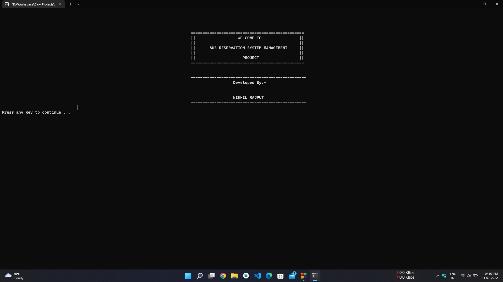
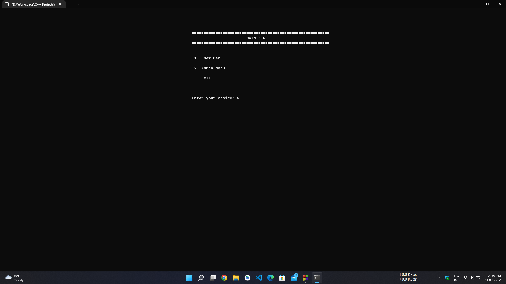
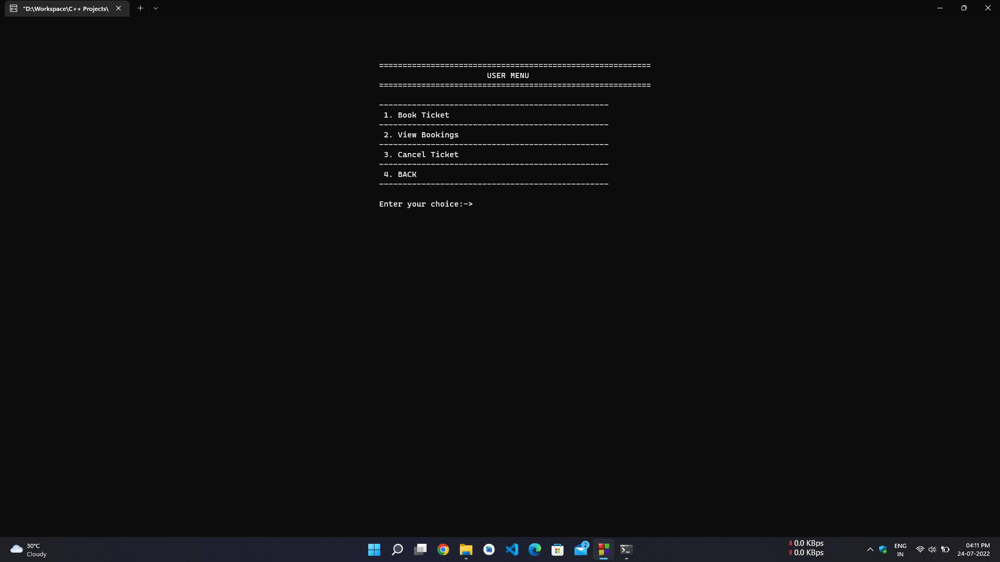
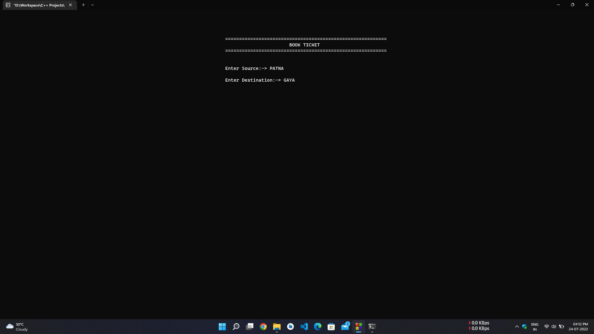
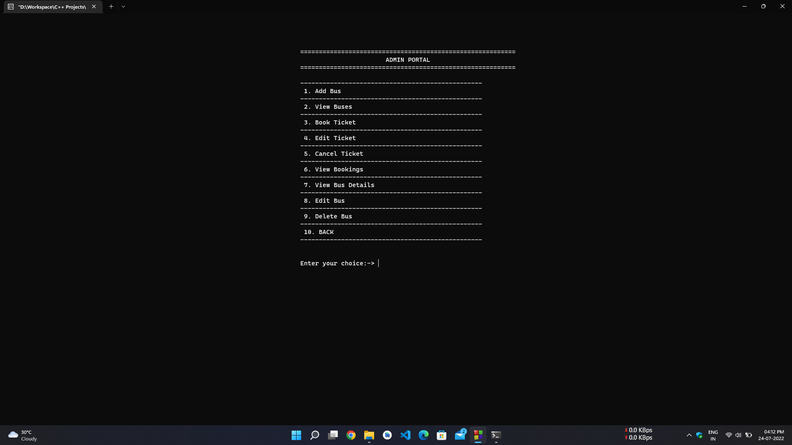
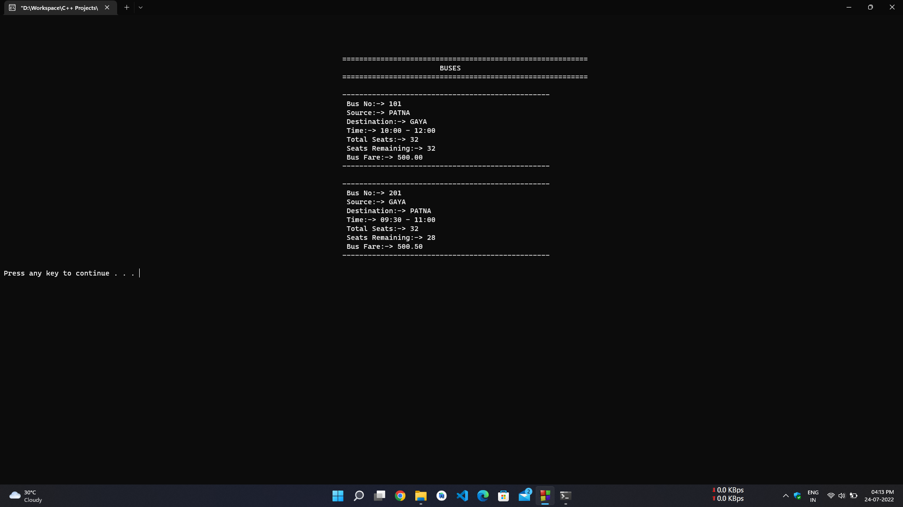

# Bus Reservation System Management with OOP and File Handling in C++

This repository contains the Bus Reservation System Management project developed using Object Oriented Programming (OOP) and File Handling concepts in C++.

[][repo]
[][repo]
[][repo]
[][repo]

[][repo]
[][issues]
[][pulls]
[][license]

## Table of Contents

- [Bus Reservation System Management with OOP and File Handling in C++](#bus-reservation-system-management-with-oop-and-file-handling-in-c)
  - [Table of Contents](#table-of-contents)
  - [Features](#features)
  - [Sceenshots](#sceenshots)
  - [Getting Started](#getting-started)
    - [Prerequisites](#prerequisites)
    - [Installation](#installation)
    - [Compilation](#compilation)
    - [Running the Application](#running-the-application)
    - [Admin Credentials](#admin-credentials)
  - [File Structure](#file-structure)
  - [Classes and Methods](#classes-and-methods)
    - [Bus Class](#bus-class)
    - [Reservation Class](#reservation-class)
    - [File Handling](#file-handling)
  - [How to Use](#how-to-use)
  - [Contributing](#contributing)
  - [License](#license)
  - [Sponsor Me](#sponsor-me)
  - [Connect With Me](#connect-with-me)
  - [Activities](#activities)

## Features

- **Bus Management**: Add, view, and remove bus details.
- **Reservation System**: Book, view, and cancel reservations.
- **File Handling**: Persist bus and reservation data using file handling techniques.
- **User Interface**: Command-line based user interface for interacting with the system.

## Sceenshots

- Welcome Screen



- Main Menu



- User Menu



- Book Ticket



- Admin Menu



- Bus List



## Getting Started

To get started with the development or usage of this project, follow the instructions below:

### Prerequisites

- A C++ compiler with C++20 support (such as g++, clang++)
- CMake 3.12 or newer, if you build with CMake
- A suitable development environment (such as Visual Studio, Code::Blocks, or a text editor with command line tools)

### Installation

1. Clone this repository to your local machine:

    ```bash
    git clone https://github.com/nixrajput/bus-reservation-system-cpp.git
    ```

2. Navigate into the cloned repository directory:

    ```bash
    cd bus-reservation-system-cpp
    ```

### Compilation

The sources are in `src/`. `src/main.cpp` includes `Bus.cpp` and `Reservation.cpp`, so compile only `src/main.cpp`. Listing the other `.cpp` files as well causes duplicate-symbol link errors.

```bash
mkdir -p build data
g++ -std=c++20 src/main.cpp -o build/BusReservationSystem
# or
clang++ -std=c++20 src/main.cpp -o build/BusReservationSystem
```

Or build and run the smoke test with CMake:

```bash
cmake -B build
cmake --build build
ctest --test-dir build --output-on-failure
```

### Running the Application

The app reads and writes its data files in `../data/`, relative to the folder you run it from. Run it from `build/`, with a `data/` folder in the project root:

```bash
cd build
./BusReservationSystem
```

### Admin Credentials

There is no default admin password. The first time you open the Admin Menu, the app asks you to set a password of at least 8 characters. Later logins ask for that password.

The app stores a random 16-byte salt and a salted SHA-256 hash, repeated 100,000 times, in `data/admin.dat`. It never stores the password itself. On macOS and Linux it creates the file as owner read/write only (`0600`). The login compares hashes in constant time.

This scheme uses only the C++ standard library and a local file, so it has limits:

- Repeated SHA-256 is not a memory-hard function such as Argon2 or scrypt. Anyone who can read `data/admin.dat` can still try weak passwords offline, so choose a long password.
- Anyone who can write to `data/` can delete `admin.dat` and set a new password. Keep the `data/` folder private.
- On Windows, the file gets the default permissions of its folder.
- The password shows on screen as you type it.

To reset a forgotten password, delete `data/admin.dat` and open the Admin Menu again.

## File Structure

The project directory typically contains the following files:

- `main.cpp`: The main entry point of the application.
- `Bus.h` and `Bus.cpp`: Bus class definition and implementation.
- `Reservation.h` and `Reservation.cpp`: Reservation class definition and implementation.
- `data/`: A directory containing data files for buses and reservations.
- `utils.h`: A file contains required utility functions.
- `admin.h`: Admin password hashing and storage.
- `test/smoke.sh`: A smoke test that drives the app with scripted input.

## Classes and Methods

### Bus Class

This class manages bus details and includes the following methods:

- `void addBus()`: Adds a new bus.
- `void displayBuses()`: Displays all buses.
- `void removeBus()`: Removes a bus by ID.

### Reservation Class

This class manages reservations and includes the following methods:

- `void bookTicket()`: Books a new ticket.
- `void viewReservations()`: Displays all reservations.
- `void cancelReservation()`: Cancels a reservation by ID.

### File Handling

Data persistence is achieved using file handling concepts. The bus and reservation data are stored in separate files within the `data/` directory.

Each ticket gets a random 10-character PNR of capital letters and digits, which no saved ticket already uses.

Upgrading from 1.1.x or earlier: 1.2.0 stores the PNR in a longer field. On its first start, the app converts `data/reservations.dat` to the new ticket layout and keeps the original file as `data/reservations.dat.bak`. If the conversion fails, the app reports the error and stops, and it leaves the original file unchanged.

## How to Use

1. **Add a Bus**: Select the option to add a bus and enter the required details.
2. **View Buses**: Select the option to view all available buses.
3. **Remove a Bus**: Select the option to remove a bus and provide the bus ID.
4. **Book a Ticket**: Select the option to book a ticket and enter the required details.
5. **View Reservations**: Select the option to view all reservations.
6. **Cancel a Reservation**: Select the option to cancel a reservation and provide the reservation ID.

## Contributing

If you would like to contribute to this project, feel free to fork the repository, make your changes, and submit a pull request. Please follow the guidelines in the [CONTRIBUTING.md](CONTRIBUTING.md) file.

## License

This project is licensed under the MIT License - see the [LICENSE](LICENSE) file for details.

## Sponsor Me

By sponsoring my efforts, you're not merely contributing to the development of my projects; you're investing in its growth and sustainability.

Your support empowers me to dedicate more time and resources to improving the project's features, addressing issues, and ensuring its continued relevance in the rapidly evolving landscape of technology.

Your sponsorship directly fuels innovation, fosters a vibrant community, and helps maintain the project's high standards of quality. Together, we can shape the future of the projects and make a lasting impact in the open-source community.

Thank you for considering sponsoring my work!

[](https://github.com/sponsors/nixrajput)

[](https://ko-fi.com/nixrajput)

[](https://www.buymeacoffee.com/nixrajput)

## Connect With Me

[][github]
[][linkedin]
[][instagram]
[][twitter]
[][telegram]
[][gmail]

## Activities


[github]: https://github.com/nixrajput
[twitter]: https://twitter.com/nixrajput07
[instagram]: https://instagram.com/nixrajput
[linkedin]: https://linkedin.com/in/nixrajput
[telegram]: https://telegram.me/nixrajput
[gmail]: mailto:nkr.nikhil.nkr@gmail.com

[repo]: https://github.com/nixrajput/bus-reservation-system-cpp
[issues]: https://github.com/nixrajput/bus-reservation-system-cpp/issues
[pulls]: https://github.com/nixrajput/bus-reservation-system-cpp/pulls
[license]: https://github.com/nixrajput/bus-reservation-system-cpp/blob/master/LICENSE
